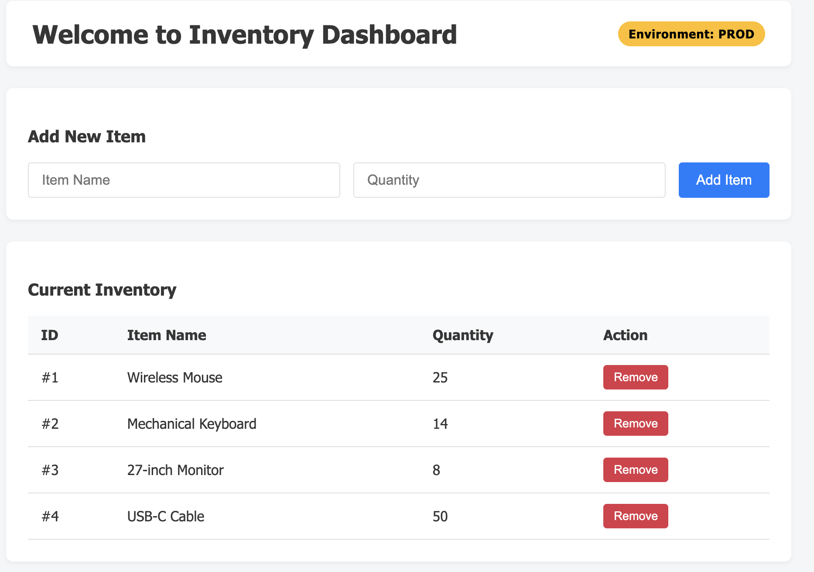

Assignment 1: Deploy a configurable Nginx website
Easy
Estimated time: 30–45 minutes

Business scenario: Your company needs to host a simple internal inventory dashboard. The website should run on Kubernetes, support multiple replicas, and display content managed through a ConfigMap.
Requirements
Resource	Requirement
Namespace	inventory-dev
Deployment	inventory-web-deployment
Docker image	nginx:alpine
Replicas	2
Container port	80
Service	inventory-web-service
Service type	ClusterIP
ConfigMap	inventory-web-config

Tasks
[ ] Create the inventory-dev namespace.
[x] Create a ConfigMap containing an index.html file.
[x] The HTML page must display "Welcome to Inventory Dashboard" and "Environment: DEV".
[x] Create an Nginx Deployment with two replicas.
[x] Mount the ConfigMap HTML file into Nginx at /usr/share/nginx/html/index.html.
[x] Create a ClusterIP Service to expose Nginx on port 80.
[x] Use kubectl port-forward to open the website at localhost:8080.
[x] Change the heading in the ConfigMap and verify the updated page appears.

The final solution should load a page like below-
