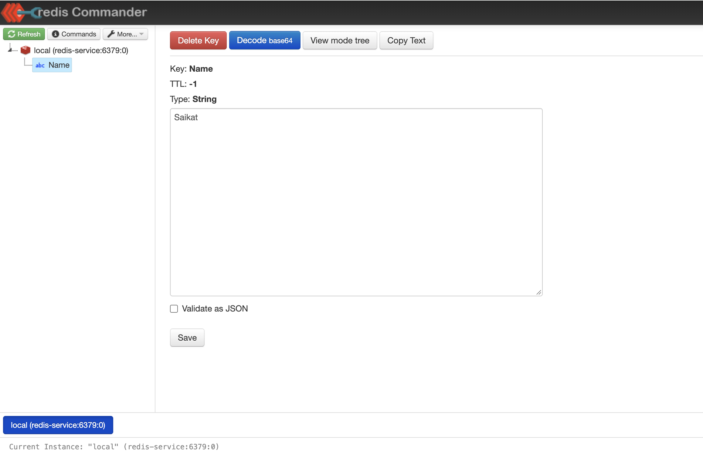

Assignment 2: Deploy Redis with Redis Commander
Medium
Estimated time: 60–90 minutes

Business scenario: Your team needs an internal Redis cache to store temporary inventory information. Developers want a web UI to inspect and manage the Redis keys.

You must deploy two applications that communicate using Kubernetes networking, similar to your MongoDB assignment.
Architecture

Requirements
Resource	Requirement
Namespace	cache-dev
Redis image	redis:7-alpine
Redis Deployment	redis-deployment
Redis replicas	1
Redis Service	redis-service
Redis port	6379
UI image	rediscommander/redis-commander:latest
UI Deployment	redis-ui-deployment
UI Service	redis-ui-service
UI port	8081
ConfigMap	redis-ui-config

Tasks
[ ] Create the cache-dev namespace.
[ ] Deploy Redis with one replica and a ClusterIP Service.
[ ] Deploy Redis Commander as a separate Deployment.
[ ] Create a ConfigMap containing REDIS_HOSTS with the value local:redis-service:6379.
[ ] Inject REDIS_HOSTS into the Redis Commander container using configMapKeyRef.
[ ] Create a ClusterIP Service for Redis Commander.
[ ] Port-forward Redis Commander to localhost:8081 and open the UI.
[ ] Create a key inventory:9004:1788249 with value 100 using redis-cli.
[ ] Verify that the new key is visible in Redis Commander.
[ ] Delete the Redis Pod and verify Kubernetes recreates it.

