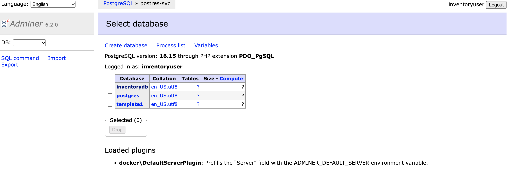

Assignment 3: PostgreSQL + Adminer
Business scenario
Your team needs a PostgreSQL database to store inventory records. Developers should be able to connect to the database using Adminer, a browser-based database management tool.

Unlike the MongoDB assignment, you must store database credentials in a Kubernetes Secret, not a ConfigMap.

Requirements
Resource	                Specification
Namespace	                database-dev
PostgreSQL Deployment	    postgres-deployment
PostgreSQL image	        postgres:16-alpine
Replicas	                1
PostgreSQL Service	        postgres-service
PostgreSQL port	            5432
Database name	            inventorydb
Username	                inventoryuser
Password	                Stored in Secret
Secret	                    postgres-secret
Adminer Deployment	        adminer-deployment
Adminer image	            adminer:latest
Adminer Service	            adminer-service
Adminer port	            8080

Your tasks
[ ] Create the database-dev namespace.
[x] Create a Kubernetes Secret containing the PostgreSQL username and password.
[x] Create a ConfigMap containing the database name inventorydb.
[x] Create the PostgreSQL Deployment and inject configuration using secretKeyRef and configMapKeyRef.
[x] Configure an emptyDir volume mounted at /var/lib/postgresql/data and set PGDATA to /var/lib/postgresql/data/pgdata.
[x] Create a ClusterIP Service for PostgreSQL.
[x] Deploy Adminer and configure ADMINER_DEFAULT_SERVER using the PostgreSQL Service name.
[x] Expose Adminer through a ClusterIP Service and port-forward to localhost:8080.
[x] Log in to PostgreSQL from Adminer and create an inventory table.
[x] Insert three inventory records and verify them using a SQL SELECT query.
9 of 10 tasks completed
Reset

Sample data
Create a table named inventory with these records:
item_id	ship_node	available_qty
1788249	9004	100
1788249	9005	50
2701019	9004	200

Choose suitable SQL data types yourself.
Bonus challenge
Delete the PostgreSQL Pod and observe what happens to your inventory records.

Explain why emptyDir does not preserve data across Pod replacement, even though it survives container restarts within the same Pod.

Don't implement persistent volumes yet. That will be a separate assignment.

