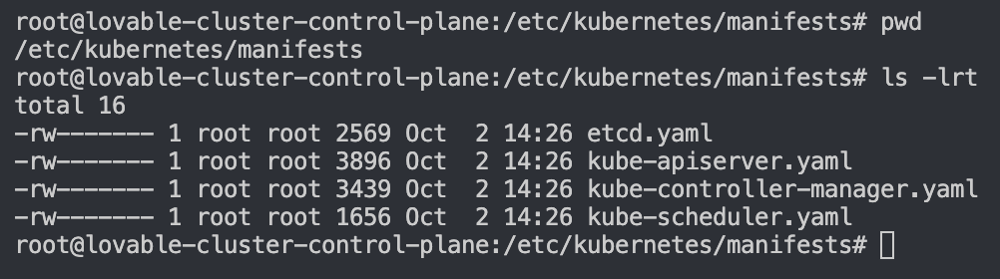

Creating the Kind Cluster-
    kind create cluster --config kind-cluster.yaml

to see the cluster details we can see this file-
cat ~/.kube/config

kubectl will look for the config file to connect with the master. So this file <<config>> is super important

going inside the master node
docker exec -it <<container>> bash
go to this path - /etc/kubernetes/manifests

kind commands-
| What you want             | Command                                                   |

| Create default cluster    | `kind create cluster`                                     |
| Create named cluster      | `kind create cluster --name dev-cluster`                  |
| Create from config        | `kind create cluster --config kind-config.yaml`           |
| List kind clusters        | `kind get clusters`                                       |
| Delete default cluster    | `kind delete cluster`                                     |
| Delete named cluster      | `kind delete cluster --name dev-cluster`                  |
| Get kubeconfig            | `kind get kubeconfig --name dev-cluster`                  |
| Load local Docker image   | `kind load docker-image my-app:1.0 --name dev-cluster`    |
| List kind nodes           | `kind get nodes --name dev-cluster`                       |
| Check kind version        | `kind version`                                            |
